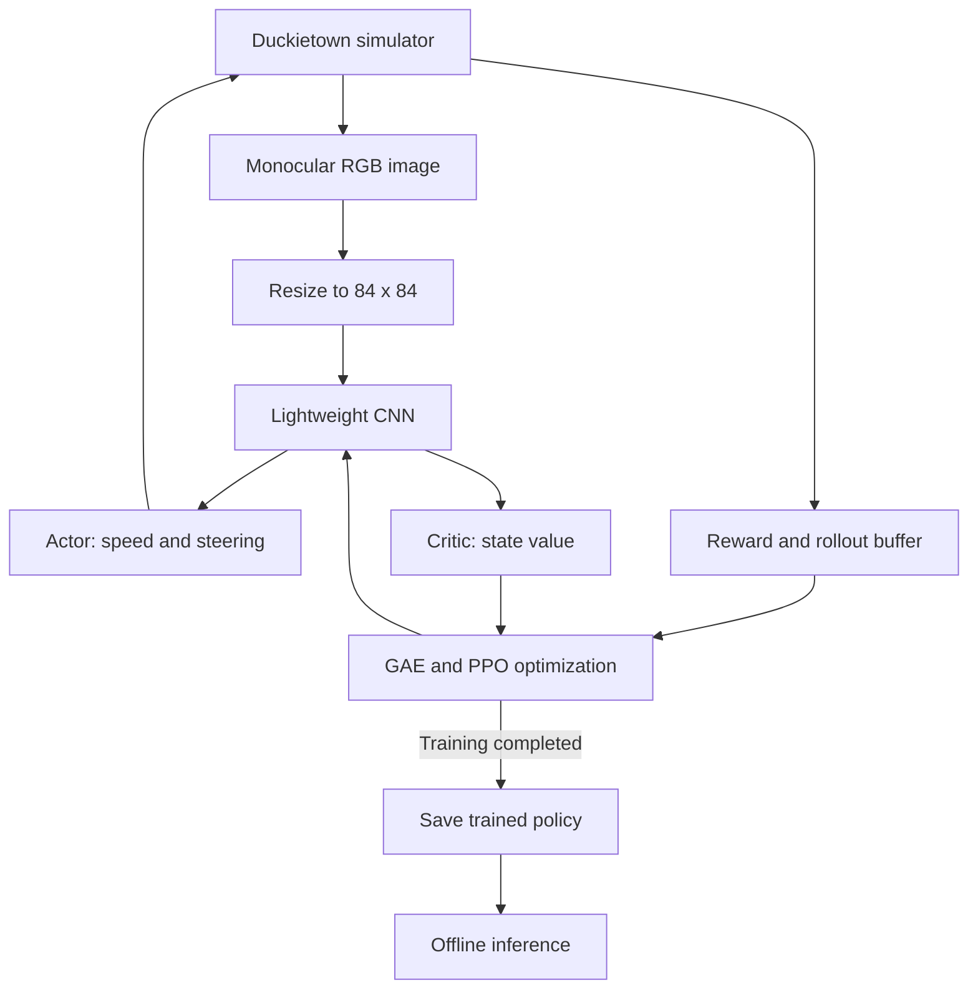

## Overview

This repository provides a reference implementation of a lightweight deep reinforcement learning (DRL) framework for autonomous lane following in Duckietown. The approach uses Proximal Policy Optimization (PPO) and a compact convolutional neural network (CNN) to predict continuous speed and steering commands directly from monocular RGB images. The objective is to support computationally efficient visual navigation and subsequent sim-to-real transfer to resource-constrained robotic platforms such as DuckieBot DB21J.


## Key features

- End-to-end monocular vision-based lane following.
- Compact CNN with three convolutional layers.
- Continuous-action PPO with Generalized Advantage Estimation (GAE).
- Reward shaping based on lane deviation, heading alignment, forward speed and steering smoothness.
- Simulator domain randomization enabled during training.
- Training logs, reward visualization and offline policy inference.
- Designed as a starting point for embedded robotic deployment.

## Repository structure

```text
.
├── train.py           # Simulator wrapper, CNN and PPO training
├── inference.py       # Offline prediction from an RGB image
├── plot_training.py  # Training convergence visualization
└── README.md          # Project documentation
```

## Methodology



The actor and critic are initialized once. During training, the agent collects environment interactions in a rollout buffer. GAE estimates advantages, and PPO optimizes the policy and value networks over multiple epochs. After training, the policy is saved and can be loaded for inference without further parameter updates.

### CNN architecture

| Layer | Output | Kernel | Stride | Activation |
|---|---|---|---|---|
| Input | 3 × 84 × 84 | — | — | — |
| Conv 1 | 32 × 20 × 20 | 8 × 8 | 4 | ReLU |
| Conv 2 | 64 × 9 × 9 | 4 × 4 | 2 | ReLU |
| Conv 3 | 64 × 7 × 7 | 3 × 3 | 1 | ReLU |
| Flatten | 3136 | — | — | — |
| Fully connected | 128 | — | — | ReLU |
| Actor head | 2 action means | — | — | Linear |
| Critic head | 1 state value | — | — | Linear |

Stable-Baselines3 normalizes the image input and manages the continuous-action policy distribution. The actor and critic share the feature extractor.

### PPO objective

$$
L^{\mathrm{CLIP}}(\theta)=\mathbb{E}_t\left[\min\left(\rho_t(\theta)\hat A_t,\operatorname{clip}(\rho_t(\theta),1-\epsilon,1+\epsilon)\hat A_t\right)\right]
$$

$$
\rho_t(\theta)=\frac{\pi_\theta(a_t\mid s_t)}{\pi_{\theta_{\mathrm{old}}}(a_t\mid s_t)}
$$

The clipping parameter is set to 0.2, following a common PPO configuration. This limits the incentive for excessive policy changes; it is not claimed to be an experimentally optimized value.

### Generalized Advantage Estimation

$$
\hat A_t=\sum_{l=0}^{T-t-1}(\gamma\lambda)^l\delta_{t+l}
$$

$$
\delta_t=r_t+\gamma V(s_{t+1})-V(s_t)
$$

These expressions illustrate GAE for a trajectory segment without an intervening termination. Stable-Baselines3 handles episode boundaries and bootstrapping internally.

### Reward function

For ordinary transitions, the proposed implementation uses:

$$
R_t=e^{-|e_l|/0.10}+0.5\cos(e_h)+0.2v_t-0.1|u_t-u_{t-1}|
$$

Here, $e_l$ is lateral lane error, $e_h$ is heading error in radians, $v_t$ is normalized forward speed and $u_t$ is normalized steering. A penalty of 5 is subtracted on termination. A recognized off-lane exception sets the base reward to -5 before the termination penalty, yielding -10. Simulator ground truth is used only for reward computation, not as policy input.

## Hyperparameters

| Parameter | Value |
|---|---|
| Image resolution | 84 × 84 × 3 |
| Learning rate | 0.0003 |
| Discount factor (γ) | 0.99 |
| PPO clipping parameter (ε) | 0.2 |
| GAE parameter (λ) | 0.95 |
| Mini-batch size | 64 |
| Rollout length | 2048 |
| Optimization epochs | 10 |
| Requested training steps | 1,000,000 |
| Optimizer | Adam (SB3 default) |
| Episode step limit | 1000 (wrapper limit) |
| Random seed | 42 |
| Default map | loop_empty |
| Domain randomization | Enabled |

The GAE parameter, rollout length, optimization epochs, reward coefficients and other implementation defaults are proposed settings requiring experimental validation.

## Installation

A working legacy `gym-duckietown` simulator installation is required. Install it and its dependencies in a compatible Python environment first. See the [Duckietown simulator repository](https://github.com/duckietown/gym-duckietown). The simulator must expose `DuckietownEnv`, `get_lane_pos2` and the expected normalized speed/steering interface. Legacy Gym dependencies may require compatibility adjustments for Gymnasium and Stable-Baselines3 2.x.

From the root of this repository, install the additional dependencies:

```bash
pip install 'stable-baselines3>=2,<3' gymnasium torch numpy opencv-python tensorboard pandas matplotlib
```

## Training

Run a short smoke test before full training:

```bash
python train.py --steps 4096 --out runs/smoke_test
```

Train the full PPO model:

```bash
python train.py --steps 1000000 --seed 42 --map loop_empty --out runs/ppo
```

A training step represents one environment interaction, not one PPO optimization update. Stable-Baselines3 completes full rollouts, so the actual number of steps may exceed the requested budget (1,001,472 for the default single-environment configuration).

Expected output after successful training:

```text
runs/ppo/
├── policy.zip
├── monitor.csv
└── tb/
```

## Training visualization

```bash
tensorboard --logdir runs/ppo/tb
```

Open `http://localhost:6006` to monitor training.

Generate a convergence figure from the recorded episode rewards:

```bash
python plot_training.py runs/ppo/monitor.csv --window 20
```

The script saves `training_curve.pdf`, showing the rolling mean episodic reward and ±1 rolling standard deviation against cumulative environment interaction steps at completed episodes. No synthetic experimental results are included.

## Offline inference

```bash
python inference.py runs/ppo/policy.zip frame.jpg
```

The script loads the policy on the CPU, converts the image to RGB, resizes it and predicts deterministic normalized forward speed and steering commands. It also reports preprocessing and prediction time. It does not send commands to a robot.

## Physical robot deployment

The intended target is DuckieBot DB21J with an NVIDIA Jetson Nano and the Duckietown ENTE software stack. Physical integration requires a compatible runtime, ROS camera and control interfaces, calibrated action mapping, safe velocity limits, a command watchdog and an emergency stop. The current repository does not implement these interfaces or online learning on the robot.

## Evaluation and reproducibility

Suggested evaluation metrics include mean lateral tracking error, lane departure rate, lap completion rate and control computation time. PID and imitation learning are relevant baselines, but their implementations are not included in this repository. Fair comparison requires equivalent test conditions and consistent timing boundaries across controllers.

The Python source has been syntax-checked, but simulation training, hardware execution and reported experimental performance have not been independently verified for this implementation. Record simulator and dependency versions, random seeds, reward parameters, training logs and hardware configuration when conducting experiments.

```

### Related references

- Schulman et al., [Proximal Policy Optimization Algorithms](https://arxiv.org/abs/1707.06347), 2017.
- Schulman et al., [High-Dimensional Continuous Control Using Generalized Advantage Estimation](https://arxiv.org/abs/1506.02438), 2016.
- [Stable-Baselines3 documentation](https://stable-baselines3.readthedocs.io/).
